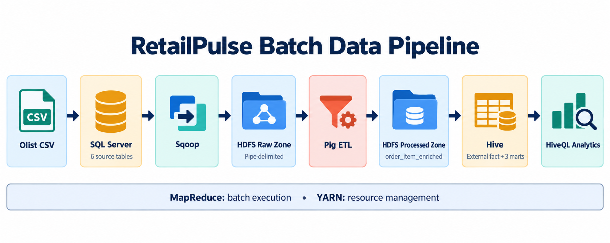

# RetailPulse: E-commerce Data Processing and Analytics Pipeline using Hadoop Ecosystem

RetailPulse is a university Big Data coursework project that demonstrates a complete batch data path across the Hadoop ecosystem. It starts with six tables from the public Olist Brazilian E-Commerce dataset in Microsoft SQL Server, imports them into HDFS with Sqoop, enriches order items with Apache Pig, and exposes analytical tables and KPIs through Apache Hive.

The repository version-controls only project code, documentation, and intentionally saved evidence. Dataset CSV files, credentials, generated Java classes, logs, and Hadoop runtime data must remain local. The repository does not install services or run the pipeline automatically; every execution step is manual and auditable.

## Problem statement

> Build an end-to-end Hadoop-based batch data pipeline that imports e-commerce transactional data from SQL Server into HDFS using Sqoop, transforms the data using Apache Pig, and analyzes sales and delivery performance using Apache Hive.

The analytical layer answers:

- How many orders were processed?
- What are total sales value, average order value, and total freight cost?
- Which product categories, customer states, and sellers generate the most sales?
- How do sales change by month?
- What is the average delivery time?
- What percentage of comparable delivered orders are late?

## Architecture



*Figure 1 — RetailPulse batch flow and the MapReduce/YARN execution foundation.*

Portable text version:

```text
Olist CSV
    |
    v
SQL Server
    |
    v
Sqoop
    |
    v
HDFS Raw
    |
    v
Pig
    |
    v
HDFS Processed
    |
    v
Hive
    |
    v
HiveQL Analytics
```

The HDFS layout is intentionally small:

```text
/retailpulse
|-- raw
|   |-- orders
|   |-- order_items
|   |-- customers
|   |-- products
|   |-- sellers
|   `-- category_translation
`-- processed
    `-- order_item_enriched
```

See [docs/architecture.md](docs/architecture.md) for the responsibilities of each layer and the roles of MapReduce and YARN.

## Technology stack

The project targets the user's existing local environment:

| Component | Version / role |
|---|---|
| macOS | Intel x86_64 host |
| Eclipse Temurin Java | 8 (`1.8.0_504`) |
| Microsoft SQL Server | 2022 source database, exposed at `localhost:1433` |
| DBeaver | Manual CSV loading and SQL execution |
| Apache Sqoop | 1.4.7 table ingestion through the SQL Server JDBC driver |
| Apache Hadoop | 2.10.2 with HDFS, YARN, MapReduce, and JobHistoryServer |
| Apache Pig | 0.17.0 ETL on MapReduce |
| Apache Hive | 2.3.9 external table, marts, and HiveQL analytics |

No installation or environment-configuration scripts are included.

## Dataset

Use only these Olist files:

1. `olist_orders_dataset.csv`
2. `olist_order_items_dataset.csv`
3. `olist_customers_dataset.csv`
4. `olist_products_dataset.csv`
5. `olist_sellers_dataset.csv`
6. `product_category_name_translation.csv`

Download them manually. They may be kept outside the repository or locally under `data/`; all CSV files are ignored by Git. See [data/README.md](data/README.md) for the exact mapping.

Payments are deliberately outside the MVP. In this project, **sales value** means the sum of `price + freight_value` across included order items. This is a coursework definition, not a payment or revenue-recognition measure.

## Analytical definitions

The processed fact is deliberately item-grained, so order-level metrics must not count the same order once per item.

| Metric | Definition used in this project |
|---|---|
| Fact grain | One row per `(order_id, order_item_id)` after excluding `canceled` and `unavailable` orders and applying the required joins. |
| Total orders | `COUNT(DISTINCT order_id)` across retained fact rows. It is not the count of every source order and is not restricted to delivered orders. |
| Total sales value | Sum of `item_total_value`, where `item_total_value = price + freight_value`. |
| Average order value | Sum item totals within each order first, then average those order totals. |
| Average order-item value | Item-grain average used only by `mart_sales_state`; it is not average order value. |
| Monthly sales | Grouped by purchase year and purchase month. |
| Delivery metrics | Restricted to delivered orders and reduced to one row per order before aggregation. |
| Late delivery rate | Percentage of delivered orders with `is_late = 1` among delivered orders for which `is_late` is computable. |

`delivery_days` and `delay_days` are signed whole-day differences. `is_late` compares exact timestamps, so an order delivered a few hours after its estimate can legitimately have `delay_days = 0` and `is_late = 1`.

The analytical layer contains only three compact marts:

| Mart | Grain and purpose |
|---|---|
| `mart_sales_category` | One row per resolved category: English name, then Portuguese name, then `unknown`. Contains distinct orders, item rows, total sales, and freight. |
| `mart_sales_state` | One row per customer state. Contains distinct orders, total sales, and the average order-item value. |
| `mart_delivery_monthly` | One row per purchase year/month. Item rows are first collapsed to one row per delivered order before delivery and lateness metrics are calculated. |

## Why each Hadoop component is used

### Why Sqoop

Sqoop demonstrates bulk, schema-oriented transfer from a relational source into Hadoop. Each SQL Server table becomes one raw HDFS dataset through JDBC. A single mapper keeps the local pseudo-distributed demo reliable and easy to follow.

### Why HDFS

HDFS provides the shared storage boundary between ingestion, ETL, and analytics. Separate raw and processed paths make the data lineage visible without introducing unnecessary zones.

### Why Pig

Pig Latin expresses the multi-table cleaning, joins, and derived delivery logic more clearly than low-level MapReduce code. The final dataset has a useful analytical grain: **one row represents one product item in one customer order**.

### Why Hive

Hive places a SQL-style analytical layer over the processed HDFS files. The fact table is external, so it references Pig output without duplicating it, while three small marts and ten readable KPI queries support the coursework demonstration.

## Repository structure

```text
retailpulse-hadoop-ecosystem/
|-- README.md
|-- .gitignore
|-- data/
|   `-- README.md
|-- sql/
|   |-- 01_create_database_and_tables.sql
|   `-- 02_source_validation.sql
|-- sqoop/
|   `-- import_raw_tables.sh
|-- pig/
|   `-- transform_order_item_enriched.pig
|-- hive/
|   |-- 01_create_external_tables.hql
|   |-- 02_create_marts.hql
|   `-- 03_kpi_queries.hql
|-- docs/
|   |-- architecture.md
|   |-- data_dictionary.md
|   `-- images/
|       `-- retailpulse-batch-data-pipeline.png
`-- results/
    |-- README.md
    `-- hive_kpi_results_2026-10-21.md
```

## Manual execution order

Run every step yourself from the repository root. Review each file before execution and stop if a validation result is unexpected.

### Step 1 — load the existing environment

The first command is:

```bash
source ~/bigdata-env.sh
```

The repository does not create or modify this file.

### Step 2 — verify the existing Hadoop daemons

```bash
jps
```

Confirm that your already-configured NameNode, DataNode, ResourceManager, NodeManager, and JobHistoryServer processes are present. Start or repair services using your own established procedure if they are not; this project deliberately contains no service-management scripts.

### Step 3 — create and load the SQL Server source

1. Connect DBeaver to SQL Server at `localhost:1433`.
2. Open `sql/01_create_database_and_tables.sql` and use DBeaver's **Execute SQL Script** action so its `GO` batch separators are handled as script delimiters.
3. Refresh the connection and select the `RetailPulse` database.
4. For each table, use DBeaver's **Import Data** action and select its matching CSV:

   | CSV file | SQL Server table |
   |---|---|
   | `olist_orders_dataset.csv` | `dbo.orders` |
   | `olist_order_items_dataset.csv` | `dbo.order_items` |
   | `olist_customers_dataset.csv` | `dbo.customers` |
   | `olist_products_dataset.csv` | `dbo.products` |
   | `olist_sellers_dataset.csv` | `dbo.sellers` |
   | `product_category_name_translation.csv` | `dbo.category_translation` |

5. Treat the first row as headers; use comma delimiter, double-quote quoting, UTF-8, and map empty nullable cells to SQL `NULL`.
6. Map columns by exact name. In particular, keep Olist's original `product_name_lenght` and `product_description_lenght` spellings.
7. Keep both `*_zip_code_prefix` columns mapped to the target `VARCHAR(5)` type so a leading zero present in the CSV is not discarded.
8. Review DBeaver's mapping and conversion preview before committing the import. Timestamps use `yyyy-MM-dd HH:mm:ss`, and decimal values use a dot.
9. For the most reliable local import, set **Disable batches** to **Yes** and **Use multi-row insert** to **No**. If a batch insert fails, stop the transfer rather than skipping rows, clear only the partially loaded target table, verify all source-to-target mappings, and retry.

The DDL does not load CSV files and does not include credentials.

### Step 4 — validate the source

Open this read-only file in DBeaver and use **Execute SQL Script** (not the single-statement action), because the file contains `GO` batch separators:

```text
sql/02_source_validation.sql
```

Review all result sets, especially source counts, duplicate keys, null identifiers, timestamp range, status distribution, and negative or null price/freight values. The first four relationship checks—orders to customers and order items to orders, products, and sellers—should each return zero unmatched rows. Missing category translations may be non-zero because Pig preserves them with a left join. Lifecycle dates and optional product attributes can legitimately be null. Resolve unexpected source issues before continuing.

### Step 5 — import all six tables with Sqoop

```bash
bash sqoop/import_raw_tables.sh
```

The default username is `sa`. To use a different SQL Server login without editing the script:

```bash
SQLSERVER_USER='your_login' bash sqoop/import_raw_tables.sh
```

Sqoop uses `-P`, so type the SQL Server password only at its prompt. Because the script runs six independent imports, it prompts once per table (six times); the script never stores the password. Each import uses one mapper, a pipe delimiter, empty fields for SQL nulls, and `--delete-target-dir`, so rerunning replaces that table's prior raw directory. An empty raw value therefore appears as adjacent, leading, or trailing `|` delimiters rather than a literal `NULL` token.

### Step 6 — verify the HDFS raw zone

```bash
hdfs dfs -ls -R /retailpulse/raw
hdfs dfs -cat '/retailpulse/raw/orders/part-m-*' | wc -l
hdfs dfs -cat '/retailpulse/raw/order_items/part-m-*' | wc -l
hdfs dfs -cat '/retailpulse/raw/customers/part-m-*' | wc -l
hdfs dfs -cat '/retailpulse/raw/products/part-m-*' | wc -l
hdfs dfs -cat '/retailpulse/raw/sellers/part-m-*' | wc -l
hdfs dfs -cat '/retailpulse/raw/category_translation/part-m-*' | wc -l
hdfs dfs -cat '/retailpulse/raw/orders/part-m-*' | sed -n '1,5p'
```

Confirm that all six directories exist and compare their line counts with the SQL validation counts. A displayed pipe-delimited sample is only a structural check; do not use it as a substitute for counts.

### Step 7 — run the Pig transformation

```bash
pig -x mapreduce pig/transform_order_item_enriched.pig
```

The script reads all six raw paths, removes only its previous processed output, excludes `canceled` and `unavailable` orders, performs the dimension joins, and writes the enriched item-grain dataset. SQL Server `DATETIME2` values may arrive from Sqoop with a fractional suffix such as `.0`; Pig accepts that suffix and normalizes valid processed timestamps to `yyyy-MM-dd HH:mm:ss`.

### Step 8 — verify the processed HDFS dataset

```bash
hdfs dfs -ls /retailpulse/processed/order_item_enriched
hdfs dfs -cat '/retailpulse/processed/order_item_enriched/part-*' | wc -l
hdfs dfs -cat '/retailpulse/processed/order_item_enriched/part-*' \
  | awk -F'|' '{print NF}' \
  | sort -nu
hdfs dfs -cat '/retailpulse/processed/order_item_enriched/part-*' \
  | sed -n '1,5p'
```

The field-count command must return only `22`. Check that fields appear in the order documented in [docs/data_dictionary.md](docs/data_dictionary.md). Missing delivery values must remain empty/null rather than becoming invented dates. The processed count can be lower than raw `order_items` because status filtering and required-key validation occur in Pig; compare it with the Hive fact count, not directly with the unfiltered raw item count. The optional category left join must not reduce the fact row count.

### Step 9 — create the Hive layer

Run the files in this order:

```bash
hive -f hive/01_create_external_tables.hql
hive -f hive/02_create_marts.hql
```

The first file creates the `retailpulse` database and recreates only the external fact metadata; it does not delete or copy the processed HDFS files. The second full-refreshes three managed ORC marts from the fact. Both files explicitly use Hive-on-MapReduce for this coursework environment.

### Step 10 — run the analytical queries

```bash
hive --hiveconf hive.cli.print.header=true -f hive/03_kpi_queries.hql
```

The file runs ten documented KPI `SELECT` statements. The optional CLI setting above prints the readable column aliases as headers. Save verified query output or screenshots under `results/` if they are needed as coursework evidence.

## Validation checklist

### SQL Server

- All six tables have non-zero counts appropriate to the downloaded files.
- Primary and composite key duplicate checks return no rows.
- Required identifiers have no unexpected nulls; review the import mapping for blank text keys because Pig also rejects blank required keys.
- Prices and freight values are non-negative.
- Purchase timestamp range and order-status distribution look plausible.

### Sqoop and HDFS raw

- Six raw HDFS directories exist.
- Each directory's line count matches its SQL source table count.
- Sample rows use `|`, and missing values appear as empty fields between delimiters.
- Rerunning an import replaces, rather than appends to, its target directory.

### Pig and HDFS processed

- The processed directory exists and contains part files.
- Every row represents one retained order item, not one order.
- `item_total_value` equals `price + freight_value` where both inputs are valid.
- Missing actual or estimated dates do not become fake delivery metrics.
- Untranslated categories remain present with a null English category.
- No retained row has order status `canceled` or `unavailable`.

### Hive

Useful manual checks after creating the tables include:

```sql
USE retailpulse;
DESCRIBE fact_order_item;
DESCRIBE FORMATTED fact_order_item;
SELECT COUNT(*) FROM fact_order_item;
SELECT COUNT(DISTINCT order_id) FROM fact_order_item;
SELECT
    order_status,
    COUNT(*) AS item_row_count,
    COUNT(DISTINCT order_id) AS order_count
FROM fact_order_item
GROUP BY order_status;
SELECT
    COUNT(*) AS total_rows,
    COUNT(DISTINCT CONCAT(order_id, '-', CAST(order_item_id AS STRING)))
        AS unique_order_items
FROM fact_order_item;
SELECT SUM(item_count) FROM mart_sales_category;
SELECT MIN(late_delivery_rate), MAX(late_delivery_rate)
FROM mart_delivery_monthly;
```

Confirm that `DESCRIBE FORMATTED` reports an external table at `/retailpulse/processed/order_item_enriched`. Compare the fact count with both the processed HDFS line count and the summed category-mart item count. Categories use English name first, Portuguese name second, and `unknown` only when both are missing. Non-null percentage-scale delivery rates must stay between `0.0` and `100.0`. Allow minor floating-point or group-rounding differences when reconciling monetary totals.

## Expected outputs

After a successful manual run, the pipeline should create:

- six pipe-delimited raw HDFS datasets below `/retailpulse/raw`;
- one pipe-delimited enriched dataset below `/retailpulse/processed/order_item_enriched`;
- external Hive table `retailpulse.fact_order_item` over that processed path;
- managed Hive tables `mart_sales_category`, `mart_sales_state`, and `mart_delivery_monthly`;
- ten KPI query outputs covering orders, sales, freight, category, state, month, delivery, and seller performance.

Exact values depend on the source files used. The following section records one real manual verification run; it is evidence, not hardcoded pipeline output.

## Verified manual run

The complete pipeline was manually executed and checked on 10 September 2026 using the versions listed above. These values came from the user's SQL, Sqoop, HDFS, Pig, and Hive output; the repository did not generate or fabricate them.

| Raw dataset | Verified rows |
|---|---:|
| `orders` | 99,441 |
| `order_items` | 112,650 |
| `customers` | 99,441 |
| `products` | 32,951 |
| `sellers` | 3,095 |
| `category_translation` | 71 |

Processed and analytical checks from the same run:

- Pig completed with `FinalApplicationStatus=SUCCEEDED` and produced 112,101 item-grain rows.
- Every processed row had 22 pipe-delimited fields.
- Hive returned 112,101 fact rows and 112,101 distinct `(order_id, order_item_id)` keys.
- No retained fact row had status `canceled` or `unavailable`.
- All four required source relationships had zero unmatched rows. Thirteen product rows with a non-null category had no translation match; the left join preserved their items.
- All six Sqoop imports, the Pig transformation, the Hive table builds, and the ten KPI queries completed successfully.

### Verified Hive KPI results — 21 October 2026

The following results were produced by a successful local run of all ten queries in [`hive/03_kpi_queries.hql`](hive/03_kpi_queries.hql) using Hive 2.3.9 on Hadoop 2.10.2 (MapReduce execution engine). These are **observed results**, not hardcoded outputs or guaranteed results for other data loads.

```bash
hive --hiveconf hive.cli.print.header=true -f hive/03_kpi_queries.hql
```

| # | KPI / analysis | Verified result |
|---:|---|---|
| 1 | Total orders | 98,199 |
| 2 | Total sales value (price + freight) | 15,735,527.03 |
| 3 | Average order value | 160.24 |
| 4 | Total freight cost | 2,241,126.29 |
| 5 | Average delivery days | 12.09 days |
| 6 | Late delivery rate | 8.11% |
| 7 | Top product category by sales | `health_beauty` — 1,437,665.78 |
| 8 | Top customer state by sales | `SP` — 5,878,132.06 |
| 9 | Highest-sales purchase month | 2017-11 — 1,172,191.68 |
| 10 | Top seller by sales | `4869f7a5dfa277a7dca6462dcf3b52b2` (guariba, SP) — 249,393.44 |

**Interpretation:** Sales value is the sum of `price + freight_value` for retained order items, **not** net profit or recognized revenue. Order-level KPIs deduplicate `order_id`; delivery metrics consider eligible delivered orders. The customer-state result uses the customer's location, not the seller's.

The detailed output of category, state, monthly, and seller queries is saved in [`results/hive_kpi_results_2026-10-21.md`](results/hive_kpi_results_2026-10-21.md). The full run took approximately 7.5 minutes on the tested machine. It is therefore recommended to execute the complete KPI script before a time-limited live presentation and demonstrate selected queries during the workshop.

## Known limitations

- The Hadoop side is a manual full-refresh batch demonstration; it has no scheduler, CDC, or incremental loads. The SQL DDL is non-destructive and does not clear source tables, so a repeated DBeaver CSV load must be managed manually.
- Sqoop refreshes six raw directories sequentially, and Pig removes then recreates its processed directory. These operations are not atomic; if a job fails midway, fix the cause and rerun the complete affected stage before analysis.
- One Sqoop mapper is appropriate for a local single-node demo but not a throughput benchmark.
- Inner joins to the required customer, product, and seller dimensions mean a fact row requires valid matching dimension keys. Category translation alone is optional and uses a left join.
- Payments, reviews, geolocation, and all non-MVP Olist files are excluded.
- Sales is defined as item price plus freight, not payment receipts, profit, or accounting revenue.
- Delivery measures depend on parseable Olist timestamps. A late-rate denominator includes only delivered orders with an actual delivery timestamp and a computable `is_late`; unknown comparisons are excluded.
- Monthly sales and monthly delivery performance are both assigned to the order's purchase month, not its delivery month.
- The text interchange format uses `|` without a separate escaping layer; verify that a different Olist CSV release has no pipe or embedded-newline characters in selected text fields.
- The scripts do not provide production concerns such as encryption policy management, audit orchestration, data masking, access control, or automated quality gates.
- Hive uses the already-initialized local Derby metastore, which is appropriate for this single-user coursework setup rather than concurrent production use.

## Troubleshooting and expected warnings

| Message or symptom | Interpretation / action |
|---|---|
| DBeaver `Can not bind statement parameter` or `index ... is out of range` | Stop the failed import, clear only that partially loaded table, verify one-to-one column mapping, set **Disable batches = Yes** and **Use multi-row insert = No**, then retry. Do not skip rows. |
| Sqoop asks for a password repeatedly | Expected: the script uses six independent `sqoop import` commands with `-P`, so it asks once per table. |
| Missing HBase, HCatalog, Accumulo, or ZooKeeper warnings | Non-fatal for this project because those integrations are not used. |
| `NativeCodeLoader` warning on macOS | Hadoop falls back to built-in Java implementations; successful jobs remain valid. |
| Multiple SLF4J bindings | Logging-classpath warning; check the final `OK`/`SUCCESS` status rather than treating it as a query failure. |
| Hive-on-MR deprecation warning | Expected for Hive 2.3.9 in this coursework environment; MapReduce is intentionally used. |
| Hive prints `Kill Command = ...` | Informational: it shows how a running job could be cancelled. It does not mean the job was killed. |
| `cat: Unable to write to output stream` after piping to `head` | `head` closed the pipe after receiving enough rows. The README uses `sed` for samples to avoid this harmless message. |
| Sqoop-generated `orders.java`, `products.java`, and similar files appear at repository root | Local code-generation artifacts, not project source. Do not commit them; remove them after the import if Sqoop leaves them behind. |

## Coursework and demo notes

For a concise live presentation:

1. Begin with the architecture diagram and explain the storage/compute boundary.
2. Show the six verified SQL/Sqoop counts and their matching HDFS raw paths.
3. Contrast 112,650 raw item rows with 112,101 retained fact rows, then state the 22-field fact grain.
4. Walk through the status filter, required joins, zero required relationship mismatches, optional category left join, and delivery derivations.
5. Use `DESCRIBE FORMATTED` to show that Hive's fact is external and points at the processed HDFS location, then show composite-key uniqueness.
6. Distinguish item count, distinct-order count, and the coursework sales definition that includes freight.
7. Run a small selection of KPIs—such as total orders, category sales, late rate, and top sellers—and use saved evidence for slower queries.
8. Explain that Pig and Hive compile batch work to MapReduce while YARN schedules its resources.

The observed Pig run took about 2 minutes 33 seconds, so pre-run full-refresh stages before a time-limited presentation and reserve live execution for short validation or selected KPI queries. Keep screenshots and verified outputs under `results/`; never present numbers that were not produced by your own manual run.
